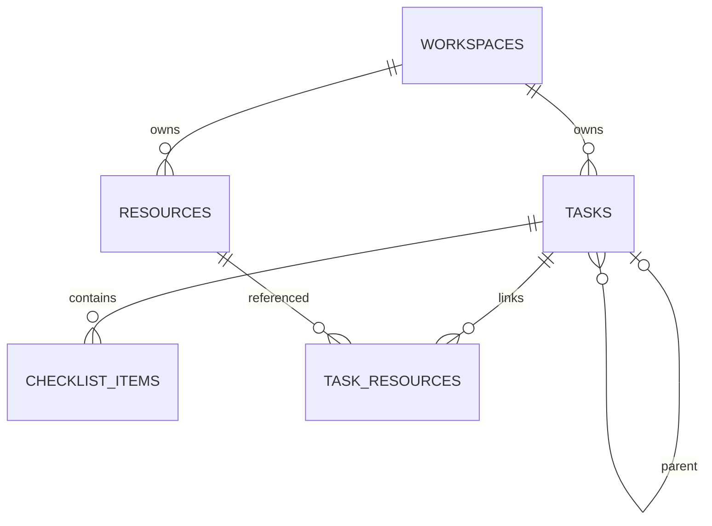

# Nhịp Việc — cấu trúc ứng dụng và thiết kế dữ liệu

Bản mở rộng 0.5 · 09/11/2026 · cá nhân, mỗi tài khoản có một workspace riêng.

## Những gì đã làm

- Todo nhiều cấp, checklist, trạng thái, tiến độ, lịch tháng/danh sách, báo cáo theo dữ liệu còn giữ.
- Pomodoro có giờ tập trung/nghỉ ngắn/nghỉ dài, số phiên, mẫu cấu hình, âm báo, tự chuyển phiên. Cài đặt trên thiết bị; đồng hồ chỉ được hỗ trợ khi app mở.
- Thư viện link Google Sheets, Docs, Slides, PowerPoint/PPTX, PDF, website. Tìm kiếm, lọc, sửa/gỡ, gắn nhiều tài liệu vào nhiều việc, mở link trong tab mới.
- Không upload tài liệu. Chỉ lưu metadata, không sao chép nội dung file. Quyền tài liệu vẫn do Google/Microsoft/website gốc quyết định.
- Tách frontend theo feature; backend có route → validation service → repository → DB. Android project và workflow build debug APK đã chuẩn bị, chưa chạy build/thiết bị.

## Phân biệt tích hợp hiện tại và phần cần làm tiếp

| Khả năng | Trạng thái |
|---|---|
| Dán link tài liệu của tài khoản Google/Microsoft | Đã có; cần tài khoản đang mở link có quyền |
| Chọn file trực tiếp từ Google Drive | Chưa có; công cụ kiểm tra eligibility cho tích hợp Sites không được cung cấp trong phiên này |
| Đọc nội dung Sheets/Docs/PPTX vào app/AI | Chưa có |
| Sửa tài liệu, theo dõi phiên bản Drive | Chưa có |
| Tạo sự kiện Google Calendar | Link tạo sự kiện thủ công và xuất .ics; chưa OAuth đồng bộ |
| AI báo cáo | Theo quy tắc; chưa có mô hình AI |
| APK tải về sẵn | Chưa có; môi trường không có SDK/Gradle |
| Android source | Có; Custom Tab online, dùng phiên trình duyệt; chưa native offline/push |

Không suy ra rằng kết nối Google trong ChatGPT tự động cấp quyền Google cho app. Không chép token của người dùng vào source hoặc APK.

## Cấu trúc source đang áp dụng

| Thư mục/file | Trách nhiệm |
|---|---|
| `app/page.tsx` | Route mỏng, render workspace |
| `features/workspace/workspace-app.tsx` | Điều phối các màn công việc/lịch/báo cáo, trạng thái màn hình và gọi API |
| `features/resources/resource-library.tsx` | Thư viện tài liệu, form link, chọn tài liệu cho công việc |
| `components/pomodoro-timer.tsx` | Giao diện, đồng hồ và cấu hình Pomodoro |
| `lib/journal.ts` | Kiểu công việc, checklist, cây việc, phần trăm, lịch |
| `lib/resources.ts` | Kiểu tài liệu, chuẩn hóa HTTP(S), nhận diện loại link |
| `lib/pomodoro.ts` | Quy tắc chu kỳ độc lập giao diện |
| `lib/journal-schema.ts` | Ràng buộc dữ liệu từ client bằng Zod |
| `app/api/workspace/route.ts` | HTTP, xác thực, same-origin, response private/no-store |
| `server/services/workspace-validation.ts` | Kiểm tra cây việc, trùng ID, liên kết tài liệu trong cùng workspace |
| `server/repositories/workspace-repository.ts` | Đọc/ghi D1 theo owner, optimistic version |
| `db/schema.ts`, `drizzle/` | Schema DB hiện tại và migrations đã dùng |
| `app/api/maintenance/retention/route.ts` | Endpoint dọn định kỳ có xác thực cho automation |
| `apps/android/` | Android shell online, không phụ thuộc build frontend |
| `.github/workflows/android-debug.yml` | Build debug APK theo thao tác workflow_dispatch |
| `scripts/test-*.mjs` | Kiểm thử timer, retention, link và quan hệ |
| `docs/schema-next.sql` | Thiết kế DB chuẩn hóa tiếp theo; KHÔNG phải migration production |

Đây là modular monolith, chung một repo và deployment web. Frontend và backend có ranh giới source nhưng chưa phải hai dịch vụ độc lập. Workspace UI còn gộp nhiều màn trong một feature; khi mở rộng thêm nên tiếp tục tách TasksView/CalendarView/ReportsView, không tạo thêm một bản copy UI/backend. Android là project riêng trong repo.

## DB thực tế đang chạy

D1/SQLite, bảng `workspaces`, khóa chính `owner`. Các cột: `data` JSON, `version`, `retention_checked_at`, `retention_deleted_count`, `retention_deleted_total`. Không chuyển Render/MongoDB trong bản cập nhật này.

JSON hiện tại:

```json
{
  "members": ["Minh Quang"],
  "tasks": [{
    "id": "task-id", "title": "Chuẩn bị báo cáo", "parentId": null,
    "project": "Cá nhân", "assignee": "Minh Quang",
    "due": "2026-11-10", "time": "09:00", "priority": "Cao",
    "status": "doing", "completedAt": null, "reminder": 15,
    "description": "Nội dung ghi chú",
    "checklist": [{"id": "c1", "text": "Kiểm tra số liệu", "done": true}],
    "resourceIds": ["resource-id"]
  }],
  "resources": [{
    "id": "resource-id", "title": "Tên tài liệu", "url": "https://example.org/",
    "kind": "website", "note": "Mục đích sử dụng", "createdAt": "2026-11-09T00:00:00.000Z"
  }]
}
```

`resources` và `resourceIds` optional để đọc dữ liệu cũ không mất thông tin. Giới hạn hiện tại: 2.000 việc/workspace, 100 checklist/việc, 500 link/workspace, 50 link/việc, tối đa 4 tên thành viên. Tên thành viên không đồng nghĩa tài khoản được chia sẻ quyền; mỗi owner vẫn tách dữ liệu.

Ưu điểm hiện tại: ít migration, lưu đơn giản cho một người, xóa việc kéo theo checklist/ghi chú nằm trong nó. Hạn chế: mỗi lần lưu gửi cả workspace; nhiều thiết bị có thể xung đột và phải tải lại, truy vấn báo cáo cần parse JSON, chưa có phân trang server, cập nhật đồng thời kém hơn DB chuẩn hóa. Version từ server được dùng trong điều kiện UPDATE; lỗi 409 không tự ghi đè bản của thiết bị khác.

## DB chuẩn hóa để mở rộng

Thiết kế dự thảo nằm trong `schema-next.sql`, đã kiểm tra cú pháp và foreign key trên SQLite bộ nhớ tạm, chưa áp dụng lên dữ liệu thật.



| Bảng | Khóa/ràng buộc | Vai trò |
|---|---|---|
| workspaces_v2 | owner PK | Một chủ sở hữu; version và dữ liệu dọn |
| tasks_v2 | PK(owner,id), FK cùng owner cho parent | Việc lớn/nhỏ, hạn, trạng thái, ghi chú |
| checklist_items_v2 | PK(owner,id), FK(owner,task_id) CASCADE | Các bước trong một việc |
| resources_v2 | PK(owner,id) | Link độc lập, không lưu blob/tài liệu |
| task_resources_v2 | PK(owner,task_id,resource_id), 2 FK CASCADE | Nhiều tài liệu ↔ nhiều công việc |

Index: (owner,status,due_date) cho bảng việc; (owner,parent_id) cho cây; (owner,completed_at) có điều kiện done cho retention; (owner,kind) cho tài liệu. Dùng khóa ghép owner để không thể gắn tài liệu/việc của tài khoản khác. Dịch vụ vẫn kiểm tra chu trình, parent chưa tồn tại, trùng ID và quyền của owner; FK không tự phát hiện chu trình.

Khi migration: backup JSON → parse và validate → import workspace/resources/tasks với parent null → đặt parent sau khi mọi task tồn tại → import checklist và liên kết → đối chiếu số lượng/trạng thái/checklist/tiến độ → chạy song song so sánh chỉ đọc → đổi repository → giữ bản rollback. Không chạy SQL dự thảo trực tiếp lên DB production hiện tại.

## Nguyên tắc dọn dữ liệu

Giữ đúng cấu hình đã chốt: 90 ngày dọn một lần; mỗi lượt xóa tất cả việc hoàn thành hơn 10 ngày, kèm checklist/ghi chú. Không tự dọn khi mở app hoặc mỗi lần lưu. Việc chưa hoàn thành giữ nguyên; việc con còn giữ được chuyển về tổ tiên còn tồn tại hoặc root trước khi xóa parent.

Link trong thư viện là tài nguyên độc lập. Xóa công việc làm mất quan hệ gắn link với công việc đó, không xóa thư viện link và tuyệt đối không xóa file gốc trên Drive/OneDrive. Gỡ link thư viện cũng gỡ các liên kết task; file gốc không thay đổi. Nếu chuyển DB chuẩn hóa, thực hiện reparent + delete tasks trong một transaction; FK task_resources/checklist xóa theo task.

Báo cáo tính từ dữ liệu đang giữ, nên việc bị dọn không còn trong lịch sử thống kê. Chưa thêm bảng số liệu lưu trữ để tránh giữ lại nội dung người dùng đã yêu cầu xóa.

## Google và lịch ở giai đoạn kế tiếp

Để chọn file từ đúng tài khoản: dùng kết nối theo từng visitor, quyền đọc metadata tối thiểu, nút Kết nối rõ ràng, chỉ yêu cầu sau khi kiểm tra nền tảng cho phép. File picker không cần đọc toàn bộ nội dung. Muốn đọc báo cáo từ Sheets/Docs/PPTX phải thêm API xử lý theo loại file, hạn mức và màn xin quyền. Không dùng tài khoản dịch vụ chung để mở tài liệu riêng tư của mọi người.

Calendar đồng bộ cần token theo user, eventId cho từng task, chính sách sửa/xóa, timezone Asia/Ho_Chi_Minh, retry/idempotency và xử lý token hết hạn. App link hiện tại không làm những bước này.

## Android và APK

Xem `apps/android/README.md`. Source sử dụng JDK 17, Gradle 8.11.1, AGP 8.9.2 và SDK 35 theo bộ tương thích AGP 8.9. Build bằng `gradle :app:assembleDebug` hoặc workflow. Chưa có Android SDK/Gradle tại môi trường phiên làm việc, chưa xác nhận APK compile/install/login trên thiết bị. Không có nút tải APK giả trong app.

Bản Android mở workspace qua Custom Tab; source 1.1 thêm widget và AlarmManager nhắc từ bản chụp thủ công, chưa build/chạy thiết bị. Chưa có đồng bộ API nền/offline workspace. Xem apps/android/README.md và REGION-EDITION.md. Để chia sẻ nhiều user, phải thiết kế account/token API ngoài phiên web hiện tại.

Nguồn build: https://developer.android.com/build/building-cmdline
Bộ tương thích: https://developer.android.com/build/releases/agp-8-9-0-release-notes

## Kiểm chứng của bản giao

- TypeScript, production build web và kiểm thử Pomodoro/retention/link/quan hệ chạy thành công khi đóng gói.
- UI preview điện thoại: đã thêm link mẫu, lưu, gắn vào việc và thấy lại công việc liên quan trong thư viện. Dữ liệu thử chỉ trong demo của preview, không thêm vào workspace thật.
- SQL dự thảo: đã thực thi trong SQLite bộ nhớ tạm; kiểm tra không gắn tài liệu khác owner và cascade chỉ xóa quan hệ/checklist, giữ nguồn tài liệu.
- Site riêng tư có cổng đăng nhập trong trình duyệt QA; chưa kiểm thử lại thao tác ghi thư viện bằng tài khoản production sau cổng đó. Việc deploy thành công không chứng minh đã đăng nhập/đọc Google Drive.
- Android project: đã kiểm tra cấu trúc, XML và bộ phiên bản theo tài liệu; chưa chạy Gradle/thiết bị. Không coi source là APK đã build.
